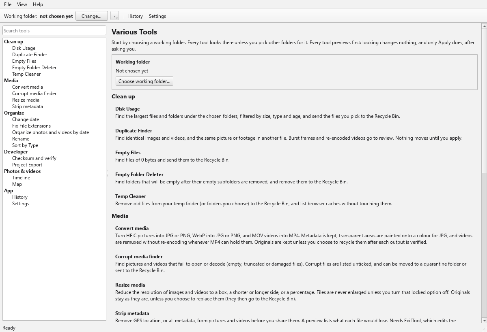
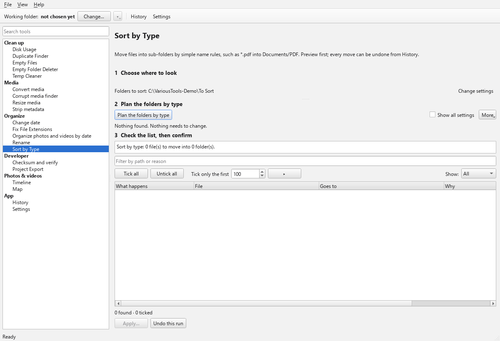
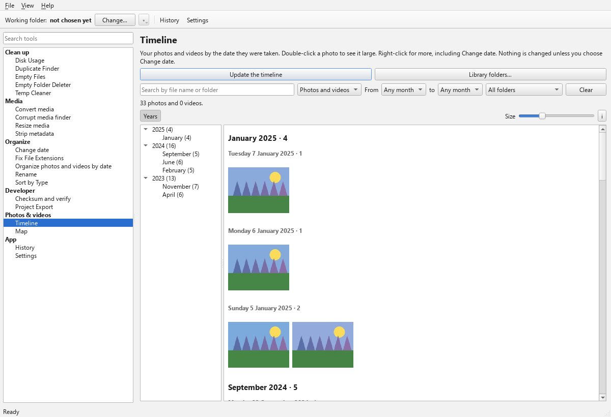
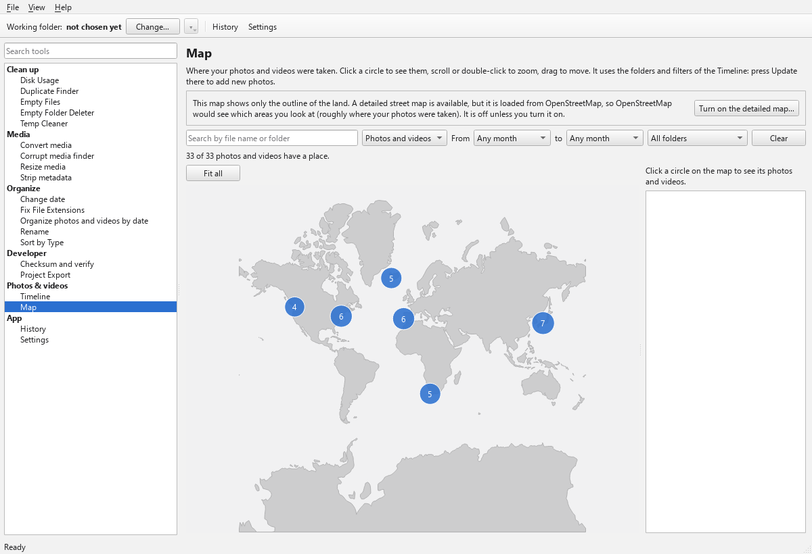
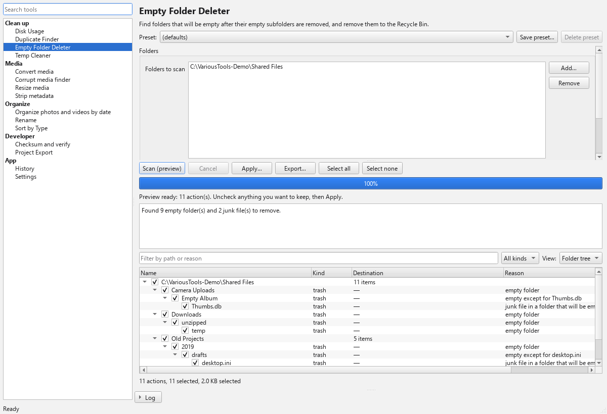
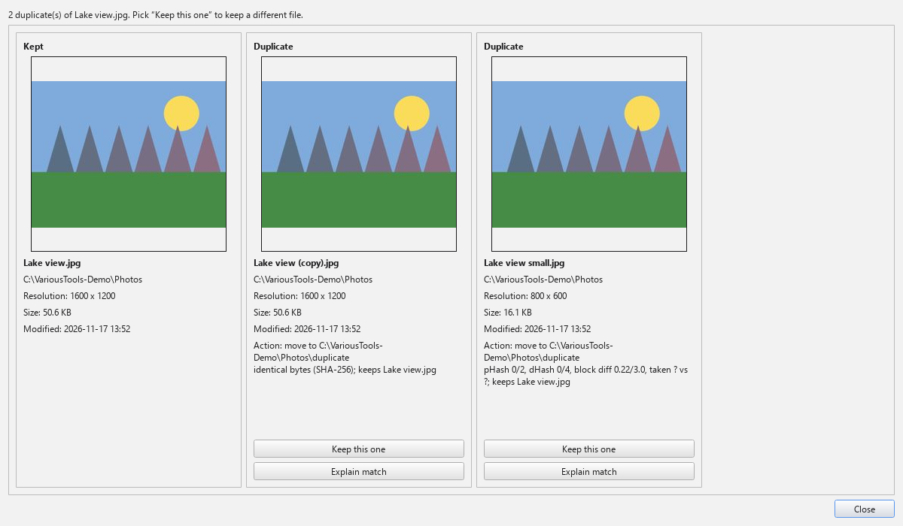
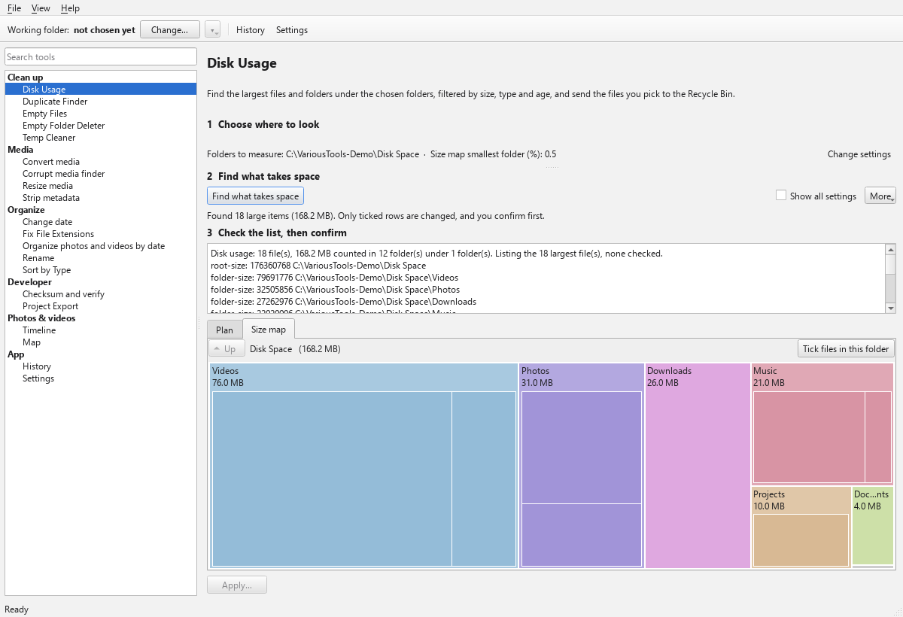
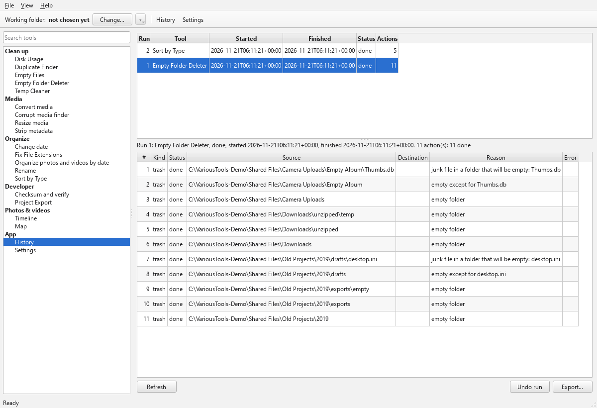
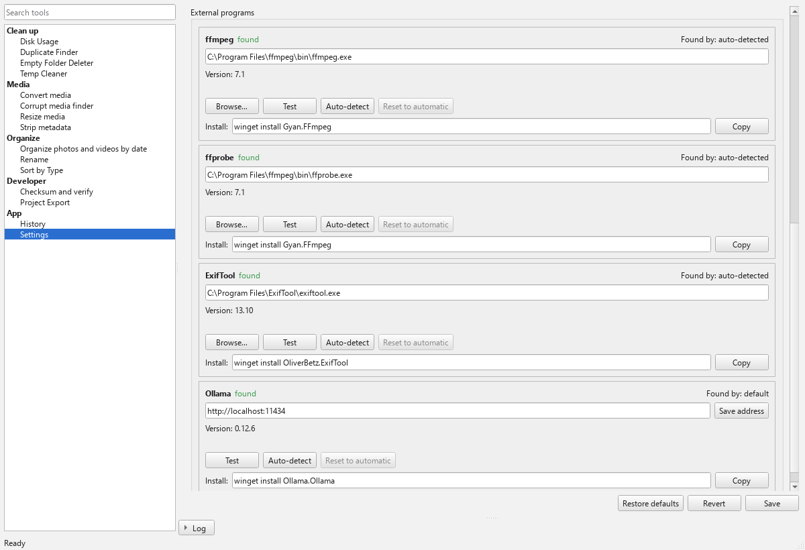

# Various Tools

Various Tools is a Windows app for tidying up files and media: empty folders, duplicates, large files, temp files, photo organizing, renaming, converting and more. One install gives you a desktop app and a command line (`various-tools`). Every tool previews first, changes nothing until you apply, sends deletes to the Recycle Bin, and records what it did in History. The plan is in [docs/MODERNIZATION_PLAN.md](docs/MODERNIZATION_PLAN.md).

This repository started as the **Empty Folder Deleter** Tkinter app; that app is now the `empty_folders` tool (see [The original Empty Folder Deleter](#the-original-empty-folder-deleter)).

## Screenshots



Home: every tool, and the working folder they share. "Choose working folder" (and Add in a tool's folder list) can pick several folders at once; the folder list on a tool page is the working folder, so a change there shows on every page.



A tool page: Sort by type, with the plan to check before applying.



Timeline: photos and videos by the date they were taken.



Map: where the photos were taken (the built-in offline map).



The Empty Folder Deleter tool: the options form and the plan as a folder tree.



Duplicates: a group side by side, with the copy that stays.



Disk Usage: the Size map tab.



History: every applied run, with Undo and Export.



Settings: the External programs panel.

The screenshots are generated on demo data by `uv run python packaging/make_screenshots.py`.

## Install

Windows 10 or 11, 64-bit. Downloads are on the [Releases](https://github.com/jay-singhvi/Empty-Folder-Deleter/releases) page.

- **Installer** (`Various-Tools-<version>-setup.exe`): installs for your Windows account only, with no admin prompt, to `%LOCALAPPDATA%\Programs\Various Tools`. It adds a Start menu shortcut and, if you tick them, a desktop shortcut and the Explorer folder menu "Open with Various Tools". It never starts with Windows. Uninstall from *Settings > Apps*; it asks whether to keep your settings and History.
- **Portable zip** (`Various-Tools-<version>-portable.zip`): unzip anywhere and double-click `Various Tools.exe`. Nothing is installed.

Either way the folder holds two programs:

- `Various Tools.exe`: the desktop app.
- `various-tools.exe`: the command line. Open a terminal in that folder (or add it to `PATH`) and run `various-tools.exe --help`.

Settings, History (the journal that makes Undo possible) and caches are kept in `%LOCALAPPDATA%\Various Tools`.

### External programs (optional)

Some features use free programs that are not bundled. The app finds them automatically (`PATH`, the winget folders and the usual install folders), or you point to them in *Settings > External programs* (or `various-tools config set external_tools.<name>.path ...`). A missing program turns off only the features that need it, and `various-tools doctor` shows what was found.

| Program | Used for | Install |
|---|---|---|
| ffmpeg and ffprobe | videos in `duplicates`, `media_resize`, `media_convert` and `corrupt_media`; video dates | `winget install Gyan.FFmpeg` |
| ExifTool | `metadata_strip`; capture dates and metadata of files Pillow cannot read (for example CR3) in `organize_by_date`, `rename`, `media_resize` and `media_convert` | `winget install OliverBetz.ExifTool` |
| Ollama (optional) | AI double check of borderline duplicate pictures | `winget install Ollama.Ollama`, then `ollama pull <model>` |

### Run from source

Needs [uv](https://docs.astral.sh/uv/) (`winget install astral-sh.uv`); uv fetches the Python version in `.python-version`.

```
git clone https://github.com/jay-singhvi/Empty-Folder-Deleter.git
cd Empty-Folder-Deleter
uv sync                       # everything, including the GUI, media and dev groups
uv run various-tools-gui      # desktop app
uv run various-tools --help   # command line
```

### Build the installer yourself

With [Inno Setup 6](https://jrsoftware.org/isinfo.php) installed (`winget install JRSoftware.InnoSetup`), `uv run python packaging/build.py --installer` builds the app, the portable zip and `dist\Various-Tools-<version>-setup.exe`. Details are in [packaging/README.md](packaging/README.md).

## Tools

Each tool has a page in [docs/tools/](docs/tools/) with its options and safety rules. Every tool previews first and changes nothing until you apply.

| Tool id | Category | What it does |
|---|---|---|
| `empty_folders` | Clean up | Remove folders that are empty, or hold only junk files. |
| `empty_files` | Clean up | Send 0-byte files to the Recycle Bin, keeping ones that are empty on purpose (`__init__.py`, `.gitkeep`). |
| `disk_usage` | Clean up | List the largest files and folders, with type and age filters. Files can be sent to the Recycle Bin (none are selected by default). |
| `temp_cleaner` | Clean up | Remove old files from temp folders (`%TEMP%` by default). Browser caches are listed but never touched. |
| `duplicates` | Clean up | Find identical pictures and videos, and the same picture or footage in another file. |
| `media_resize` | Media | Reduce the resolution of pictures and videos. |
| `media_convert` | Media | Convert HEIC and WebP to JPG or PNG, and MOV to MP4. Originals are kept by default. |
| `metadata_strip` | Media | Remove GPS or all metadata before sharing, into a new folder by default. |
| `corrupt_media` | Media | Find pictures and videos that fail to open or decode, and quarantine or trash them. |
| `organize_by_date` | Organize | Move photos and videos into year and month folders by capture date. |
| `sort_by_type` | Organize | Move files into subfolders by type, using editable rules such as `*.pdf=Documents/PDF`. |
| `wrong_extension` | Organize | Find files whose content does not match their extension (a PNG named `.jpg`) and rename them. |
| `rename` | Organize | Give a batch of files one name pattern, dated from their capture, modified or created time. |
| `project_export` | Developer | Write a folder's file list and contents to one text file, for example for an AI assistant. |
| `checksum` | Developer | Create or verify SHA-256 manifests (`sha256sum` format), for example to check a backup. |

## Command line: `various-tools`

Every tool is available from the command line. The flags are generated from each tool's options, so the CLI, the GUI and the docs always agree. Run the commands as `various-tools.exe ...` from the installed or unzipped folder, or `uv run various-tools ...` from a source checkout (after `uv sync`). The examples below write `various-tools`.

```
various-tools list                          # the tools: id, name, category, description
various-tools TOOL scan  [PATHS] [flags]    # preview. Changes nothing
various-tools TOOL apply [PATHS] [flags]    # the same, then apply (asks first)
various-tools history [RUN_ID]              # what was applied, and each run's actions
various-tools undo RUN_ID                   # reverse a run
various-tools download [PATHS] [--plan F]   # download cloud-only OneDrive files a scan skipped (asks first)
various-tools doctor                        # are ffmpeg, ffprobe, ExifTool and Ollama available?
various-tools config show|get|set|unset     # settings
various-tools export FILE --run ID|--plan F # CSV, Excel, HTML or text report
various-tools TOOL scan --help              # every flag, with its meaning, default and limits
```

### Preview first, then apply

`scan` never changes anything on disk. It prints a table of the actions (kind, source, destination, reason, whether it is selected) and the totals. Only `apply` changes files, and it shows the same table and asks for confirmation unless you pass `--yes`.

```
# 1. Preview, and save the plan so it can be read in an editor (or by an AI) first.
various-tools empty_folders scan "D:\Photos" --save-plan plan.json

# 2. Apply exactly that plan. Edit "selected" in the file to leave actions out.
various-tools empty_folders apply --plan plan.json

# Or skip the plan file: apply takes the same flags as scan.
various-tools rename apply "D:\Chats" --opt-preset snapchat

# Machine-readable output (only JSON on stdout), for scripts:
various-tools duplicates scan "D:\Photos" --media images --json > plan.json
```

Rules that always hold (the same as in the app):

- Deletes go to the Recycle Bin. Permanent delete needs the setting `delete_mode = permanent` and asks a second, explicit question (`--yes` skips both questions for scripts). Without `--yes`, a run with nobody to answer is refused.
- `various-tools undo RUN_ID` moves and renames files back, restores items from the Recycle Bin when they are still there, and sends an output file a tool wrote (an export, a converted or resized copy, a manifest) to the Recycle Bin if it is unchanged. Permanent deletes cannot be undone.
- OneDrive cloud-only files are never read or downloaded by a scan; they are reported as skipped. Downloading needs your explicit action: `various-tools download`, the download button in the app, or the `cloud_only` option of `organize_by_date` (see below).
- `Ctrl+C` stops a running scan or apply at the next safe point and exits with code 130.

### Options and settings

Flags are written as `--field-name`. A switch is `--flag/--no-flag`. A list is repeated or comma-separated (`--treat-as-empty a.tmp,b.tmp`). A dictionary is repeated as `KEY=VALUE`. Flags you leave out keep their default, and an empty value (`--match ""`) puts a "use the app setting" option back to its default. Options marked "Advanced" in `--help` are tuned values; the locked ones (marked with a padlock) are safety values or thresholds tuned on real data, so leave them alone unless you know why. A flag that changes a locked value asks first; `--allow-locked` accepts it without asking (`--yes` does not). If a tool option has the same name as a command flag (for example rename's `preset`), it is written `--opt-preset`.

```
# Settings live in the per-user config folder (the path is shown by: various-tools config show).
various-tools config show
various-tools config set workers 4
various-tools config set external_tools.exiftool.path "C:\Program Files\Exiftool\exiftool.exe"
various-tools config unset external_tools.exiftool.path
```

Global options go before the command and apply to that run only; nothing is saved:

```
various-tools --config D:\portable\settings.toml --ffmpeg D:\tools\ffmpeg.exe duplicates scan D:\Videos --media videos
```

`--config FILE` (or the `VARIOUS_TOOLS_CONFIG` environment variable) chooses the settings file, and `--exiftool`, `--ffmpeg`, `--ffprobe` and `--ollama-url` override one program for one run. The four program options are also accepted after the command, on tool commands and on `doctor`.

Exit codes: `0` done, `1` failure, refusal, partial apply or a declined question, `2` usage or validation error (bad flag, bad value, unknown name), `130` cancelled with `Ctrl+C`.

### Old script to new command

Every documented use of the original scripts has a command. All of them preview by default; the old `--move` becomes `apply`.

| Original script and usage | New command |
|---|---|
| `empty_folder_deleter.py` (Tkinter: pick a folder, Start, review, confirm) | `various-tools empty_folders scan FOLDER`, then `various-tools empty_folders apply FOLDER`. Junk files and exclusions: `--treat-as-empty`, `--exclude-globs`; age: `--min-age-days`; permanent delete: `--delete-mode permanent` (also needs the setting). |
| `app.py` (Streamlit resolution reducer: preset, percentage or custom box, JPEG quality, video CRF, dry run, new folder or overwrite) | `various-tools media_resize scan FOLDER` then `apply`. Size presets: `--mode fit_box --size 720p` (`360p`, `480p`, `720p`, `1080p`, `2k`, `4k`); custom box: `--size custom --max-width W --max-height H`; percentage: `--mode percent --percent 50`; shorter side: `--mode shorter_side --target-px 1080`; JPEG quality: `--jpeg-quality 85`; video: `--media videos` or `both`, `--video-quality high\|medium\|low`, `--video-crf N`; output: `--output new_folder --output-folder-name resized` `--output suffix --suffix-tag _resized`, or replace the originals with `--output overwrite --allow-overwrite` (the originals go to the Recycle Bin). The dry-run checkbox is `scan`. |
| `python-find_duplicates.py` (image duplicates; `--move`) | `various-tools duplicates scan FOLDER... --media images` (the input-list file becomes the folder arguments), then `various-tools duplicates apply FOLDER... --media images` for `--move`. Exact copies only: `--exact-only`. Trash instead of the `duplicate` folder: `--action trash`. Thresholds: `--phash-max`, `--dhash-max`, `--aspect-tol`, `--pixel-block-max`, `--burst-phash-max`. |
| `python-find_duplicates.py --verify --model M` (Ollama check of borderline pairs) | `various-tools duplicates scan FOLDER... --media images --verify-with-ollama --ollama-model M`; Ollama address: `--ollama-url URL` (before the command) or `config set ollama_url URL`. |
| `python-find_duplicates.py --explain A B` | `various-tools duplicates explain A B` (the same checks table and a verdict; `--phash-max`, `--dhash-max`, `--aspect-tol`, `--pixel-block-max` to experiment). |
| `find_duplicate_videos.py` (video duplicates; `--move`) | `various-tools duplicates scan FOLDER... --media videos`, then `apply` for `--move`. Thresholds: `--dur-tol-s`, `--dur-tol-pct`, `--frame-mean-max`, `--frame-worst-max`, `--sample-at 0.1,0.5,0.9`. Needs ffmpeg and ffprobe (`various-tools doctor`). |
| `python-extract_file_metadata-8.py` (organize by date; `--move`, `--dry-run-move`, `--recursive`, `--workers`, `--errors-only`, `--skip-processed`) | `various-tools organize_by_date scan SOURCE...` for `--dry-run-move`, `apply` for `--move`. `--recursive`, `--workers N`, `--errors-only`, `--skip-processed` keep their names. Destination: `--dest-root`; folder layout: `--folder-template "{year}/{year} - {month:02d}"`; date sources: `--date-priority`. Resizing while organizing: `--also-resize` with `--resize-mode`, `--resize-px`, `--resize-jpeg-quality`. CR3 conversion and removal of the CR3 originals: `media_resize` (`--convert-raw-to-jpeg`, `--remove-raw-originals`). Cloud-only OneDrive files: `--cloud-only skip\|ask\|download` (default `skip`; replaces the old script's yes/no download answers), with `--download-wait-seconds` and `--keep-pinned`. The Excel master log is the media catalog: `organize_by_date catalog-export PATH` writes it as `.xlsx` or `.csv`, and `organize_by_date catalog-import PATH` imports the old `Photo_Metadata_Master.xlsx` once. |
| `rename_snapchat.py` | `various-tools rename scan FOLDER --opt-preset snapchat`, then `apply`. Other built-in presets: `whatsapp`, `screenshot`. Your own pattern: `--match "IMG_*.jpg" --template "Trip-{date:%Y%m%d}-{counter:03}{ext}"`. Name clashes are listed and never overwritten. |
| `python-v3-Extract_Project_Code.py` (project source into one text file) | `various-tools project_export scan FOLDER --mode contents`, then `apply`. `--exts .py,.ipynb`, `--exclude-globs`, `--strip-comments/--no-strip-comments`, `--include-markdown-cells`, `--include-outputs`, `--output-format txt\|md`, `--output-path FILE`, `--copy-to-clipboard`. |
| `python-v1-Extract_Project_Structure.py` (list project files with filters) | `various-tools project_export scan FOLDER --mode tree --exts .py,.md --exclude-globs .git,.venv`, then `apply` to write the listing. |

## Recipes

A recipe is a saved, named list of steps; each step is a tool with its options. Open **Recipes**
in the sidebar (App section) or the View menu. Make a recipe with New and Add step, or add the
current options of any tool page with **More > Save as recipe step...**. Three starters are
offered on the empty page: "Tidy a folder", "Prepare photos to share" and "Fix photo names".

**Run recipe** goes through the steps one by one on the working folder. Each step scans first
and shows its list with the usual Apply window (batches and the OneDrive wait included); nothing
changes until you apply. After the apply, or on **Skip this step**, the next step opens; **Stop**
ends the recipe. Every step is its own journaled run, so History shows "Recipe: NAME, step 2 of
3", and **Undo this recipe run** undoes the steps from last to first after one question.

On the command line (the folders are given because the command line has no working folder):

```
various-tools recipe list
various-tools recipe show "Tidy a folder"
various-tools recipe run "Tidy a folder" D:\Photos            # scans the first step only
various-tools recipe run "Tidy a folder" D:\Photos --apply    # each step: scan, ask, apply
```

Recipes live in `recipes.json` next to `settings.toml`. A step whose tool or options no longer
fit is marked "needs attention" and blocks the run until it is changed. A file that cannot be
read is renamed to `recipes.json.bad-<time>`, never discarded. Details: [docs/recipes.md](docs/recipes.md).

## Desktop app

Start *Various Tools* from the Start menu, or double-click `Various Tools.exe`. From a source checkout run `uv run various-tools-gui` (or `python -m various_tools.gui`). Every tool has a page in the sidebar, grouped by category, with a search box.

- **Tool page:** three numbered steps in plain words: *1 Choose where to look*, *2* a button that says what it looks for ("Look for empty folders", "Find duplicates"), and *3 Check the list, then confirm*, which appears after the first scan. The confirm button says what it will do ("Move 12 to the Recycle Bin…"). One **Show all settings** switch (top right of step 2, remembered, the same on every page) shows every extra option, the kind filter, the view switch, Select all / none and the log; with it off they are folded away, never removed. Right-click any row of the list for **Show in File Explorer** (the file is selected), **Open** (in its default app; a cloud-only OneDrive file asks before it is downloaded) and **Copy path**; a duplicate row offers both *this copy* and *the kept copy*, a move both *where it is now* and *where it will go*. Duplicate groups show the full path of the copy that is kept.
- **Photos & videos:** a *Timeline* (by year and month, with thumbnails) and a *Map* (by GPS
  place) of the folders you choose. *Update* reads only new or changed files. Files only in
  OneDrive are listed but never downloaded. The map works offline; a detailed OpenStreetMap
  map can be switched on in Settings (off by default, because it sends the viewed area to
  OpenStreetMap).
- **Options form:** generated from the tool's options (basic options shown, advanced ones folded under *More settings for this tool*, a padlock on tuned or safety values, which ask before they change). Drop folders from Explorer onto any folder field. The page remembers the folders and options you used last; 🔒 locked options, permanent delete and options that replace or remove originals always start from their defaults, and *More > Reset options to defaults* puts the rest back. The scan button changes nothing and a **Cancel** button shows while it runs; the confirm button asks first, and asks again before a permanent delete; *More* holds Export. The list can be sorted, filtered, grouped (for example per duplicate group), checked and unchecked, and shows totals. The progress bar and the scan notes appear only when there is something to show; the log panel is collapsible. Closing the window during a run asks first and waits for the run to stop.
- **Plan views:** Empty Folder Deleter opens its plan as a **folder tree** (the folders under each chosen folder, with every action at its path). You can switch to the grouped view.
- **Disk Usage:** a **Size map** tab next to the plan shows folder sizes as a treemap. *Tick files in this folder* checks the files of the folder you are looking at. `tree_depth` and `tree_min_share_pct` set how deep and how fine the map is.
- **Cloud-only files:** when a scan skipped OneDrive files that are only in the cloud, the page offers **Download these N files...**. Nothing is downloaded until you click it and confirm.
- **Organize by date:** two extra buttons, *Export catalog...* (the media catalog as Excel or CSV) and *Import old master log...* (a one-time import of `Photo_Metadata_Master.xlsx`).
- **Sort by type:** the rules are edited as a table.
- **Duplicates:** the Ollama model field offers a live list of the models on your Ollama server. *Compare group* shows a group side by side (thumbnail, resolution, size, date, reason); you can choose which copy to keep, and *Explain match* shows every check. Cloud-only OneDrive files are never opened for a preview.
- **Rename:** the table is a live preview of old name to new name while you edit the template.
- **History:** every applied run with its actions, **Undo**, and **Export**.
- **Settings:** every setting with its explanation, the theme (light, dark or follow Windows), and **External programs** (ffmpeg, ffprobe, ExifTool, Ollama: status, path, version, Browse, Test, Auto-detect, Reset and the `winget install` command). A tool page also offers *Locate...* when a feature needs a missing program.
- **Explorer menu (optional, off by default):** turn on *Folder right-click menu* in Settings to add "Open with Various Tools > Find empty folders / Find duplicates" for your Windows account (no admin). It runs `"Various Tools.exe" --tool ID --folder PATH`. The installer can add the same menu, and uninstalling removes it.

### Tool options added since the first release

- `organize_by_date`: `cloud_only` (`skip`, `ask` or `download`; locked, default `skip`; a download happens at Apply, never during a scan), `download_wait_seconds`, `keep_pinned`, and `also_resize` with its size options (`resize_mode`, `resize_px`, `resize_jpeg_quality`).
- `media_resize`: `output = overwrite`, which also needs `allow_overwrite`, and `remove_raw_originals`. Both send originals to the Recycle Bin and are journaled; both are off by default.
- `disk_usage`: `tree_depth` and `tree_min_share_pct` for the size map.
- `project_export`: `copy_to_clipboard`.

Each tool's page in [docs/tools/](docs/tools/) lists every option.

### Reports

Any plan, applied run or History entry can be exported as CSV, an Excel workbook, a self-contained HTML report (with thumbnails for duplicate groups), the old duplicates review list (`.txt`) or the old duplicates CSV log. From the command line:

```
various-tools duplicates scan "D:\Photos" --export review.html     # plan report
various-tools empty_folders apply "D:\Old" --export done.xlsx      # what was applied
various-tools export report.csv --run 12                           # a run from History
various-tools export report.html --plan plan.json
```

`--export` and `export` never replace an existing file unless you add `--force`.

## The original Empty Folder Deleter

The first app in this repository was a small Tkinter program, `empty_folder_deleter.py`, that found and deleted empty folders. It is replaced by the `empty_folders` tool, which adds junk-file rules, exclusions, a minimum age, the Recycle Bin by default, History and Undo; the table in [Old script to new command](#old-script-to-new-command) maps its use. The original scripts are no longer in the repository root: the copies the parity tests run are in `tests/fixtures/legacy_reference/` and are used only by those tests, and the `legacy/` folder is deleted. The old per-machine installer and its "start on Windows startup" option are gone.

## Contributing

Contributions are welcome! Please feel free to submit a Pull Request. Developer guidance (stack, layout, commands and safety rules) is in [AGENTS.md](AGENTS.md).

## License

This project is licensed under the MIT License - see the [LICENSE](LICENSE) file for details.

## Acknowledgments

- The app icon is drawn in code (`src/various_tools/gui/icon.py`).
- Place names: GeoNames (geonames.org), CC BY 4.0.

## Support

If you encounter any problems or have any suggestions, please [open an issue](https://github.com/jay-singhvi/Empty-Folder-Deleter/issues) on GitHub.

---

Developed with ❤️ by Jay Singhvi

## Gentle on OneDrive

`apply` can work in batches: `--batch-size N --pause 5m`. Add `--wait-for-upload` (with an optional `--upload-timeout 30m`, 30 minutes by default) to also wait, after each batch, until OneDrive has uploaded the files that batch wrote. The Apply window has the same choice. Files OneDrive cannot report on count as uploaded, and nothing is downloaded to check.
